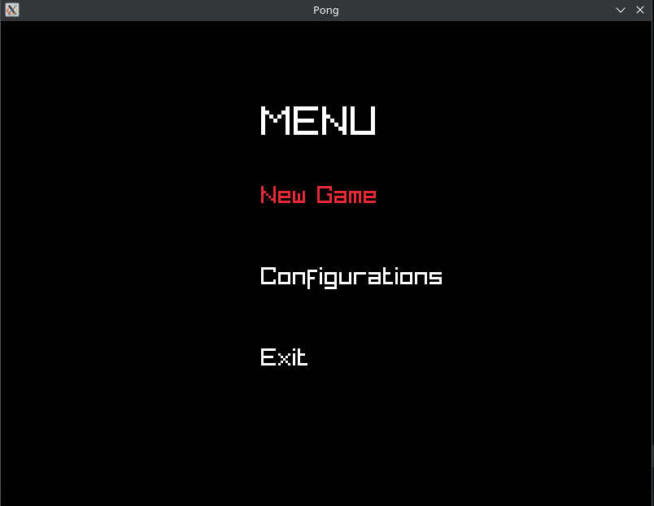
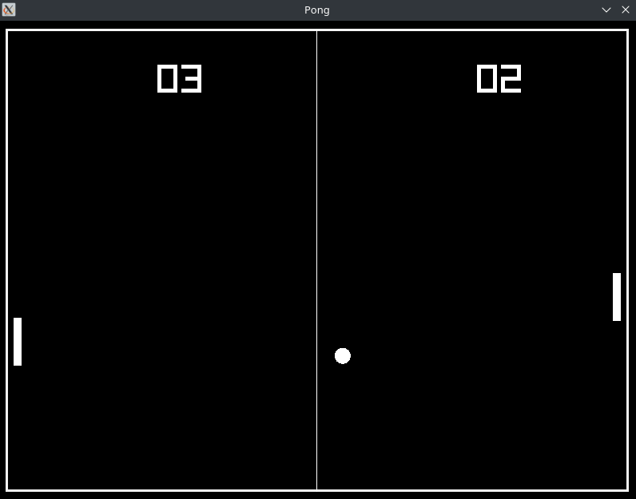
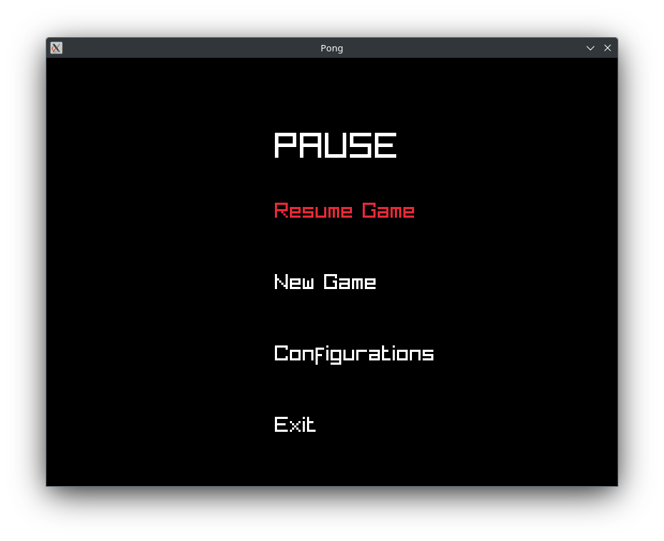
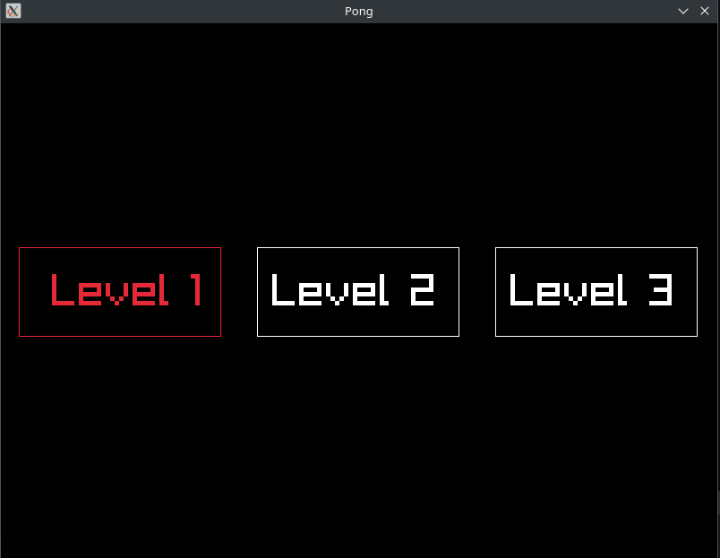

# Pong

Simple Pong game built with C and Raylib

## Table of Contents
1. [About the Project](#about-the-project)
2. [Install](#install)
3. [Getting Started](#getting-started)

## About the project

Pong. Everyone knows it. Made a thousand times by many others before me. Why bother pushing another version of this game? Well, because I wanted to learn
to use Raylib (it seemed fun) and also i wanted to learn about:

1. Semantic Releases
2. Automatic Build

My goal is not only to make a fully functional game, but to build it automatically with every push (so you can just go to releases and download it)
and to implement semantic releases with every push.

In the first commit the game is left uncompleted on purpose. With the following pushes, features will be included and i will verify if automatic build
works accordingly. The next features to be implemented are:

- [x] Add second player and score view
- [x] Add Sound
- [x] Add Menu to configure certain details of the game

## Install
On the right side, go to releases and check the latest version pushed to this repository.
The features are described with each version. Each version also includes 3 files to download (for linux, mac and windows).
Click on the file with your operating system to download it. Afterwards, just make it executable and click on it to start playing!

## Getting started
### Main Menu

When you launch the game you'll see the main menu. From here you can:

- **Play:** start a match between two players. 
- **Settings:** adjust the game options.
- **Quit:** close the game.

Navigate the menu with  ↑ / ↓ and Enter.

### How to Play

The goal is to bounce the ball back with your paddle and make your opponent miss it. Every time the ball gets past a player, the other one scores a point. <!-- COMPLETE: score needed to win -->

**Controls**

| Action | Player 1 | Player 2 |
|--------|----------|----------|
| Move up | `↑` | `W` |
| Move down | `↓` | `S` |
| Pause | `P or Space` | `P or Space`|

### Pause

You can pause the match at any time with `P` or `Space`. From the pause menu you can:

- **Resume:** go back to the match.
- **New Game:** Begin a new game. 
- **Configurations:** Change the level of the match

### Settings

Inside the configurations you can change the level of the match. With each level, the ball moves faster and rackets move faster. In level 3, the ball moves even faster but rackets move at same speed as level 2, to make it more difficult.
